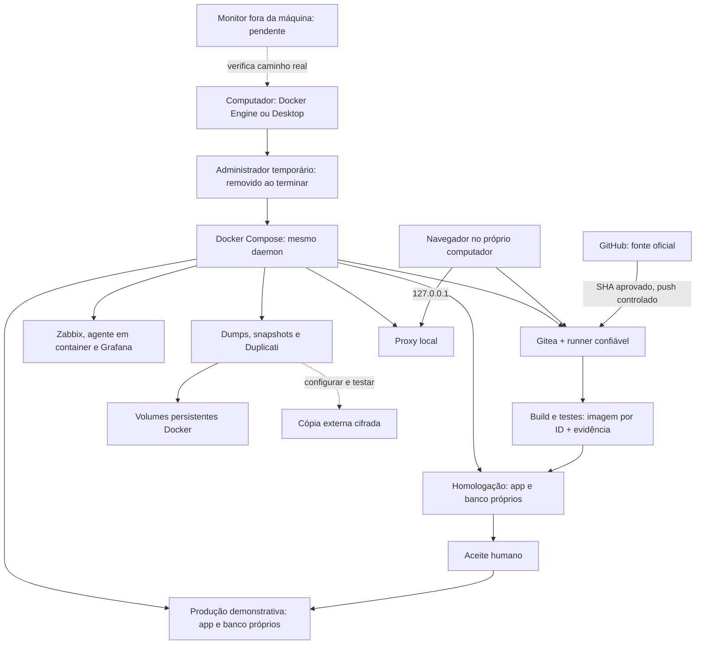

# Arquitetura Docker local

## Serviços e fronteiras

Um projeto Compose tem 15 definições de serviços: proxy, Gitea, runner opcional, dois bancos de aplicação, duas aplicações opcionais, banco/servidor/web/agente Zabbix, Grafana, backup, Duplicati e Portainer opcional. O administrador temporário é iniciado pelo lançador, fora do ciclo de vida do Compose; `down` não tenta removê-lo durante sua própria execução. Não executa Docker-in-Docker nem um Debian completo dentro de container.

| Rede | Uso |
|---|---|
| proxy (`microlab-proxy`, externa) | Interfaces web, aplicações, checks HTTP e administrador |
| ci_cd (`microlab-ci`) | Gitea, runner e jobs |
| backend, interna | Produção e seu banco |
| staging_backend, interna | Homologação e seu banco |
| monitoring | Zabbix, agente, banco de monitoramento, Grafana e backup |

O lançador cria a rede proxy antes de iniciar o administrador e cria os volumes compartilhados ao montá-los. Os serviços usam volumes Docker e DNS de serviço; não dependem de caminhos como `/var/lib/microlab` no computador. O único mount de host é o socket Docker usado pelo runner/Portainer opcionais e pelo administrador autorizado.

## Persistência

| Volume | Conteúdo |
|---|---|
| microlab-workspace | Código runtime, `.env` privado, estado de releases e clone de sincronização |
| microlab-runtime-config | Configurações de Grafana, agente, scripts de backup e runner |
| microlab-backups | Dumps e snapshots; também montado no administrador em `/workspace/backups` |
| microlab-backup-status | Timestamp público do último conjunto validado, lido pelo agente |
| microlab-ci-evidence | Evidências de candidatos testados |
| Demais volumes Compose | Bancos, repositórios, contas, certificados e configurações das ferramentas |

Só há um laboratório por daemon com esses nomes. Não executar uma segunda cópia esperando isolamento. Não existe migração automática de dados de uma VM anterior; esta mudança foi preparada para início novo. Se houver dados reais, planejar exportação/restauração e validação antes da troca.

## Limites operacionais

Todos os acessos publicados são locais, em `127.0.0.1`. Tailscale não é requisito. Acesso da equipe em computadores diferentes depende de uma extensão de rede ainda não configurada; Docker não cria conectividade remota por si só.

O agente recebe o nome fixo `microlab-docker`; ele observa sua visão de processos, filesystem e kernel Linux. No Desktop, parte dessa visão pertence à base Linux/VM interna do Docker. Não deve ser apresentada como métricas completas do Windows ou do hardware físico. Não há descoberta/alerta de estado de cada container por socket de monitoramento nesta revisão.

Runner, Portainer e administrador com acesso Docker controlam o daemon, mesmo com redes separadas. Somente colaboradores confiáveis podem executar workflows. O administrador usa `--rm`, sem `--privileged`, e não permanece como serviço; durante sua execução ainda tem autoridade administrativa.

Monitor externo, canais de alerta e storage externo precisam de configuração e teste. Suspensão do computador, Docker parado ou perda da máquina afetam todos os serviços. O ambiente não é HA nem demonstra zero downtime. Manter monitoramento da máquina real e administração do sistema operacional como etapa própria quando houver servidor físico ou virtual de destino.
